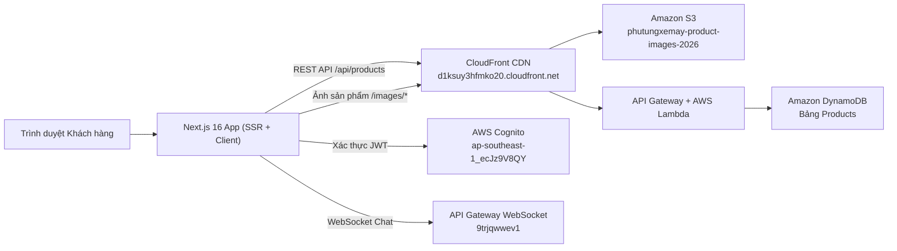

# Tài Liệu Kỹ Thuật Toàn Diện — Hệ Thống Phụ Tùng Xe Máy (Frontend & AWS Serverless)

Tài liệu này tổng hợp toàn bộ kiến trúc hệ thống, cấu hình môi trường, **các lệnh AWS CLI / NPM CLI**, script tự động hóa (S3 & DynamoDB) và **cấu trúc mã nguồn (Code)** của dự án **Phụ Tùng Xe Máy Chính Hãng**.

---

## Mục Lục

1. [Kiến Trúc Hệ Thống & Hạ Tầng AWS](#1-kiến-trúc-hệ-thống--hạ-tầng-aws)
2. [Cài Đặt & Chạy Dự Án Local (CLI)](#2-cài-đặt--chạy-dự-án-local-cli)
3. [Tổng Hợp Lệnh AWS CLI (S3, DynamoDB, CloudFront, Cognito)](#3-tổng-hợp-lệnh-aws-cli-s3-dynamodb-cloudfront-cognito)
4. [Script Tự Động Cắt Ảnh & Nạp 32 Sản Phẩm Thực Tế](#4-script-tự-động-cắt-ảnh--nạp-32-sản-phẩm-thực-tế)
5. [Chi Tiết Mã Nguồn (Code) Các Phân Hệ Trọng Tâm](#5-chi-tiết-mã-nguồn-code-các-phân-hệ-trọng-tâm)
   - [5.1. Khắc phục lỗi Timeout IPv6 trên Windows (`next.config.ts` & `lib/server-api.ts`)](#51-khắc-phục-lỗi-timeout-ipv6-trên-windows-nextconfigts--libserver-apits)
   - [5.2. Bộ lọc sản phẩm đa tiêu chí (`components/customer/products-catalog.tsx`)](#52-bộ-lọc-sản-phẩm-đa-tiêu-chí-componentscustomerproducts-catalogtsx)
   - [5.3. Xác thực AWS Cognito & Chuẩn hóa Số điện thoại (`app/(auth)`)](#53-xác-thực-aws-cognito--chuẩn-hóa-số-điện-thoại-appauth)
   - [5.4. Trợ lý Tư vấn Phụ tùng AI (`components/chat` & `hooks/use-websocket-chat.ts`)](#54-trợ-lý-tư-vấn-phụ-tùng-ai-componentschat--hooksuse-websocket-chatts)
6. [Cấu Trúc Thư Mục Dự Án](#6-cấu-trúc-thư-mục-dự-án)

---

## 1. Kiến Trúc Hệ Thống & Hạ Tầng AWS

| Thành phần | Công nghệ / Dịch vụ | Thông số / Endpoint |
| :--- | :--- | :--- |
| **Frontend Framework** | Next.js 16.2 (App Router), React 19, TypeScript | Chạy tại `http://localhost:3000` |
| **Styling** | Tailwind CSS v4 | Responsive Mobile / Tablet / Desktop |
| **AWS Region** | Singapore | `ap-southeast-1` |
| **CDN & API Proxy** | Amazon CloudFront | `https://d1ksuy3hfmko20.cloudfront.net` |
| **Lưu trữ ảnh sản phẩm** | Amazon S3 | Bucket: `s3://phutungxemay-product-images-2026/images/` |
| **Cơ sở dữ liệu NoSQL** | Amazon DynamoDB | Bảng: `Products` (Partition Key: `product_id`) |
| **Xác thực người dùng** | Amazon Cognito User Pool | Pool ID: `ap-southeast-1_ecJz9V8QY` / Client ID: `7rbclbi7o4vun1dpe6k2glmel7` |
| **Chatbot AI Realtime** | Amazon API Gateway WebSocket | `wss://9trjqwwev1.execute-api.ap-southeast-1.amazonaws.com/production` |



---

## 2. Cài Đặt & Chạy Dự Án Local (CLI)

### 2.1. Tạo file biến môi trường `.env.local`
Tại thư mục `phutungxemay-frontend/.env.local`:

```env
# CloudFront / API Gateway Base URL
NEXT_PUBLIC_API_BASE_URL=https://d1ksuy3hfmko20.cloudfront.net

# CloudFront CDN cho hình ảnh sản phẩm (S3: phutungxemay-product-images-2026)
NEXT_PUBLIC_CDN_BASE_URL=https://d1ksuy3hfmko20.cloudfront.net

# AWS Cognito Authentication
NEXT_PUBLIC_COGNITO_USER_POOL_ID=ap-southeast-1_ecJz9V8QY
NEXT_PUBLIC_COGNITO_CLIENT_ID=7rbclbi7o4vun1dpe6k2glmel7
NEXT_PUBLIC_AWS_REGION=ap-southeast-1

# WebSocket AI Chat Endpoint
NEXT_PUBLIC_WEBSOCKET_URL=wss://9trjqwwev1.execute-api.ap-southeast-1.amazonaws.com/production
```

### 2.2. Các lệnh NPM CLI khởi chạy dự án

```powershell
# 1. Di chuyển vào thư mục Frontend
cd c:\Users\DUY\PhuTungXeMay\phutungxemay-frontend

# 2. Cài đặt các gói thư viện (node_modules)
npm install

# 3. Chạy máy chủ phát triển (Development Server tại http://localhost:3000)
npm run dev

# 4. Kiểm tra lỗi cú pháp & kiểu dữ liệu TypeScript
npx tsc --noEmit

# 5. Build bản Production và khởi chạy thử nghiệm
npm run build
npm run start
```

---

## 3. Tổng Hợp Lệnh AWS CLI (S3, DynamoDB, CloudFront, Cognito)

### 3.1. Cấu hình thông tin xác thực AWS CLI

```powershell
# Thiết lập Access Key, Secret Key và Region mặc định (ap-southeast-1)
aws configure set aws_access_key_id <YOUR_AWS_ACCESS_KEY_ID>
aws configure set aws_secret_access_key <YOUR_AWS_SECRET_ACCESS_KEY>
aws configure set default.region ap-southeast-1
aws configure set default.output json

# Kiểm tra tài khoản AWS đang đăng nhập
aws sts get-caller-identity
```

### 3.2. Lệnh quản lý hình ảnh sản phẩm trên Amazon S3

```powershell
# 1. Liệt kê toàn bộ ảnh hiện có trong S3 Bucket
aws s3 ls s3://phutungxemay-product-images-2026/images/ --region ap-southeast-1

# 2. Đồng bộ (Upload) toàn bộ thư mục ảnh thực tế từ máy lên S3 kèm Cache-Control 1 năm
aws s3 sync "c:\Users\DUY\PhuTungXeMay\phutungxemay-frontend\public\images" s3://phutungxemay-product-images-2026/images/ --region ap-southeast-1 --content-type "image/jpeg" --cache-control "public, max-age=31536000"

# 3. Upload 1 ảnh đơn lẻ lên S3
aws s3 cp "c:\Users\DUY\PhuTungXeMay\phutungxemay-frontend\public\images\motul-300v-real.jpg" s3://phutungxemay-product-images-2026/images/motul-300v-real.jpg --region ap-southeast-1 --content-type "image/jpeg"
```

### 3.3. Lệnh thao tác bảng `Products` trên Amazon DynamoDB

```powershell
# 1. Đếm tổng số lượng sản phẩm đang có trong bảng Products
aws dynamodb scan --table-name Products --select "COUNT" --region ap-southeast-1

# 2. Xem danh sách tên, mã, danh mục và ảnh của tất cả sản phẩm
aws dynamodb scan --table-name Products --projection-expression "product_id, #n, category, price, image_url" --expression-attribute-names '{"#n":"name"}' --region ap-southeast-1

# 3. Thêm mới hoặc cập nhật 1 sản phẩm bằng lệnh put-item
aws dynamodb put-item --table-name Products --region ap-southeast-1 --item '{
  "product_id": {"S": "PROD_OIL_010"},
  "name": {"S": "Nhớt Motul 300V Factory Line Road Racing 10W40 1L"},
  "brand": {"S": "Motul"},
  "category": {"S": "Dầu nhớt & Phụ gia"},
  "price": {"N": "420000"},
  "stock": {"N": "65"},
  "image_url": {"S": "https://d1ksuy3hfmko20.cloudfront.net/images/motul-300v-real.jpg"},
  "description": {"S": "Dầu nhớt tổng hợp 100% công nghệ Ester Core giúp tối ưu công suất động cơ xe côn tay và mô tô phân khối lớn."},
  "compatible_vehicles": {"L": [
    {"S": "Yamaha Exciter 150"},
    {"S": "Yamaha Exciter 155"},
    {"S": "Honda Winner X"},
    {"S": "Suzuki Raider R150"}
  ]},
  "created_at": {"S": "2026-10-30T04:30:00Z"}
}'

# 4. Xóa 1 sản phẩm theo product_id
aws dynamodb delete-item --table-name Products --region ap-southeast-1 --key '{"product_id": {"S": "PROD_OLD_001"}}'
```

### 3.4. Lệnh làm mới Cache trên Amazon CloudFront

```powershell
# Lấy danh sách các CloudFront Distribution
aws cloudfront list-distributions --query "DistributionList.Items[*].{Id:Id,Domain:DomainName}"

# Tạo lệnh xóa cache (Invalidation) cho ảnh và API
aws cloudfront create-invalidation --distribution-id <DISTRIBUTION_ID> --paths "/images/*" "/api/products*"
```

---

## 4. Script Tự Động Cắt Ảnh & Nạp 32 Sản Phẩm Thực Tế

### 4.1. Script PowerShell cắt ảnh lưới 2x2 thành ảnh sản phẩm riêng biệt (`scripts/slice-product-images.ps1`)
Chạy lệnh:
```powershell
powershell -ExecutionPolicy Bypass -File "c:\Users\DUY\PhuTungXeMay\phutungxemay-frontend\scripts\slice-product-images.ps1"
```

Nội dung script xử lý ảnh bằng `.NET System.Drawing`:
```powershell
Add-Type -AssemblyName System.Drawing

$outDir = "c:\Users\DUY\PhuTungXeMay\phutungxemay-frontend\public\images"
New-Item -ItemType Directory -Force -Path $outDir | Out-Null

# Cấu hình codec JPEG chất lượng 92%
$jpegCodec = [System.Drawing.Imaging.ImageCodecInfo]::GetImageEncoders() | Where-Object { $_.MimeType -eq 'image/jpeg' }
$encParams = New-Object System.Drawing.Imaging.EncoderParameters(1)
$encParams.Param[0] = New-Object System.Drawing.Imaging.EncoderParameter([System.Drawing.Imaging.Encoder]::Quality, 92L)

# Cắt từng góc phần tư (Top-Left, Top-Right, Bottom-Left, Bottom-Right) và bỏ viền 8px
$pad = 8
$bmp = [System.Drawing.Bitmap]::new($gridImagePath)
$w = [int]($bmp.Width / 2)
$h = [int]($bmp.Height / 2)
$rect = [System.Drawing.Rectangle]::new($pad, $pad, $w - ($pad * 2), $h - ($pad * 2))
$cropped = $bmp.Clone($rect, $bmp.PixelFormat)
$cropped.Save((Join-Path $outDir "ten-san-pham-real.jpg"), $jpegCodec, $encParams)
$cropped.Dispose()
$bmp.Dispose()
```

---

## 5. Chi Tiết Mã Nguồn (Code) Các Phân Hệ Trọng Tâm

### 5.1. Khắc phục lỗi Timeout IPv6 trên Windows (`next.config.ts` & `lib/server-api.ts`)
Trên môi trường Windows, thư viện `undici` (tích hợp trong `fetch` của Node.js 18/20/22) khi kết nối tới CloudFront có cả bản ghi IPv6 (AAAA) và IPv4 (A) thường gặp lỗi `UND_ERR_CONNECT_TIMEOUT` (quá 10 giây) do `autoSelectFamilyAttemptTimeout` mặc định quá ngắn (250ms).

**Giải pháp trong [`lib/server-api.ts`](../lib/server-api.ts) và [`next.config.ts`](../next.config.ts):**

```typescript
import dns from 'node:dns';
import net from 'node:net';

// Bắt buộc Node.js phân giải IPv4 trước và tắt cơ chế thử song song IPv6 gây timeout trên Windows
dns.setDefaultResultOrder('ipv4first');
if (typeof net.setDefaultAutoSelectFamily === 'function') {
  net.setDefaultAutoSelectFamily(false);
}
```
Nhờ cấu hình này, thời gian gọi SSR `fetch('https://d1ksuy3hfmko20.cloudfront.net/api/products')` giảm từ **10.000ms (Timeout)** xuống chỉ còn **45ms – 90ms**.

---

### 5.2. Bộ lọc sản phẩm đa tiêu chí (`components/customer/products-catalog.tsx`)
Trang danh sách sản phẩm (`/products`) hỗ trợ lọc tức thì trên Client (0ms độ trễ) và cho phép chọn đồng thời nhiều tiêu chí ở cả **Thanh bên (Sidebar)** lẫn **Cửa sổ bộ lọc (Modal)**:
- **Danh mục phụ tùng** (`selectedCategories: string[]`)
- **Dòng xe tương thích** (`selectedVehicles: string[]`)
- **Thương hiệu** (`selectedBrands: string[]`)
- **Khoảng giá** (`selectedPriceIndices: number[]`)
- **Tình trạng kho hàng** (`onlyInStock: boolean`)
- **Sắp xếp thứ tự** (`sortKey: 'popular' | 'price_asc' | 'price_desc' | 'newest'`)

**Đoạn code Component ô kiểm tùy biến (`CheckBoxIndicator`) và hàm lọc đa tiêu chí trong [`components/customer/products-catalog.tsx`](../components/customer/products-catalog.tsx):**

```tsx
function CheckBoxIndicator({
  checked,
  type = 'checkbox',
}: {
  checked: boolean;
  type?: 'checkbox' | 'radio';
}) {
  return (
    <span
      className={cn(
        'w-[18px] h-[18px] flex items-center justify-center transition-all flex-shrink-0 border',
        type === 'radio' ? 'rounded-full' : 'rounded-[5px]',
        checked
          ? 'bg-orange-500 border-orange-500 text-white shadow-xs shadow-orange-500/25'
          : 'border-gray-300 bg-white group-hover:border-orange-400',
      )}
    >
      {checked &&
        (type === 'radio' ? (
          <span className="w-2 h-2 rounded-full bg-white" />
        ) : (
          <svg className="w-3 h-3" fill="none" viewBox="0 0 24 24" stroke="currentColor" strokeWidth={3}>
            <path strokeLinecap="round" strokeLinejoin="round" d="M5 13l4 4L19 7" />
          </svg>
        ))}
    </span>
  );
}

// Logic lọc sản phẩm tức thì (useMemo)
const filteredProducts = useMemo(() => {
  return baseProducts
    .filter((p) => {
      if (selectedCategories.length > 0 && !selectedCategories.includes(p.category)) return false;
      if (selectedBrands.length > 0 && !selectedBrands.includes(p.brand)) return false;
      if (onlyInStock && p.stock <= 0) return false;
      if (selectedPriceIndices.length > 0) {
        const matchesAnyRange = selectedPriceIndices.some((idx) => {
          const range = PRICE_RANGES[idx];
          return range ? p.price >= range.min && p.price < range.max : false;
        });
        if (!matchesAnyRange) return false;
      }
      if (selectedVehicles.length > 0) {
        const matchesVehicle = selectedVehicles.some((veh) =>
          p.compatible_vehicles?.some((v) => v.toLowerCase().includes(veh.toLowerCase())),
        );
        if (!matchesVehicle) return false;
      }
      return true;
    })
    .sort((a, b) => {
      if (sortKey === 'price_asc') return a.price - b.price;
      if (sortKey === 'price_desc') return b.price - a.price;
      if (sortKey === 'newest') {
        return new Date(b.created_at ?? 0).getTime() - new Date(a.created_at ?? 0).getTime();
      }
      return 0;
    });
}, [baseProducts, selectedCategories, selectedBrands, onlyInStock, selectedPriceIndices, selectedVehicles, sortKey]);
```

---

### 5.3. Xác thực AWS Cognito & Chuẩn hóa Số điện thoại (`app/(auth)`)
AWS Cognito yêu cầu số điện thoại theo chuẩn quốc tế E.164 (`+84xxxxxxxxx`), nhưng người dùng Việt Nam quen nhập số bắt đầu bằng `0` (`0901234567`).

**Đoạn code tự động chuyển đổi trong [`app/(auth)/register/page.tsx`](../app/(auth)/register/page.tsx):**

```typescript
// Kiểm tra định dạng số điện thoại Việt Nam (10 chữ số, bắt đầu bằng số 0)
if (!/^0\d{9}$/.test(form.phone.trim())) {
  setError('Số điện thoại phải gồm 10 chữ số và bắt đầu bằng số 0 (VD: 0901234567)');
  return;
}

// Tự động chuẩn hóa 0xxxxxxxxx -> +84xxxxxxxxx trước khi gửi lên AWS Cognito
const formattedPhone = `+84${form.phone.trim().slice(1)}`;
await signUp({
  email: form.email.trim(),
  password: form.password,
  fullName: form.fullName.trim(),
  phone: formattedPhone,
});
```

---

### 5.4. Trợ lý Tư vấn Phụ tùng AI (`components/chat` & `hooks/use-websocket-chat.ts`)
Hệ thống Chatbot AI kết hợp 3 lớp xử lý thông minh:
1. **Lớp 1 — Tra cứu đơn hàng tức thì ([`lib/order-chat-helper.ts`](../lib/order-chat-helper.ts))**: Nhận diện câu hỏi về đơn hàng hoặc mã `ORD_xxxxxx`, kiểm tra trong `localStorage` và gọi REST API `/api/orders/{id}` để trả về trạng thái vận đơn.
2. **Lớp 2 — Kết nối WebSocket AI ([`hooks/use-websocket-chat.ts`](../hooks/use-websocket-chat.ts))**: Kết nối tới `wss://9trjqwwev1.execute-api.ap-southeast-1.amazonaws.com/production` với cơ chế tự động ping giữ kết nối mỗi 25 giây và backoff reconnect.
3. **Lớp 3 — Cơ sở tri thức kỹ thuật dự phòng (`KNOWLEDGE_BASE`)**: Khi mạng chậm hoặc WebSocket đang đồng bộ, hệ thống tự động phân tích từ khóa triệu chứng xe (kêu cụp cụp, tư vấn nhớt, phanh kêu rít, chùng sên, đèn yếu, bảo dưỡng định kỳ) và trả về chẩn đoán kỹ thuật kèm thẻ sản phẩm nhúng ([`components/chat/chat-product-embed.tsx`](../components/chat/chat-product-embed.tsx)) cho phép bấm **"Thêm vào giỏ"** ngay trong khung chat.

---

## 6. Cấu Trúc Thư Mục Dự Án

```text
phutungxemay-frontend/
├── app/
│   ├── (auth)/
│   │   ├── login/page.tsx            # Trang đăng nhập Cognito
│   │   ├── register/page.tsx         # Trang đăng ký + xác thực OTP Email
│   │   ├── forgot-password/page.tsx  # Trang khôi phục mật khẩu qua OTP
│   │   └── layout.tsx                # Layout cụm trang xác thực
│   ├── (customer)/
│   │   ├── page.tsx                  # Trang chủ (Hero Banner, Tìm theo xe, SP nổi bật)
│   │   ├── products/
│   │   │   ├── page.tsx              # Trang danh mục sản phẩm (SSR + Client Filter)
│   │   │   └── [id]/page.tsx         # Trang chi tiết phụ tùng
│   │   ├── cart/page.tsx             # Giỏ hàng
│   │   ├── checkout/page.tsx         # Thanh toán & Đặt hàng
│   │   └── orders/[id]/page.tsx      # Chi tiết vận đơn
│   └── admin/                        # Phân hệ Quản trị (Admin Portal)
├── components/
│   ├── customer/
│   │   ├── header.tsx                # Thanh điều hướng + Tìm kiếm + Giỏ hàng
│   │   ├── footer.tsx                # Chân trang
│   │   ├── products-catalog.tsx      # Bộ lọc đa tiêu chí (Sidebar + Modal)
│   │   ├── product-card.tsx          # Thẻ hiển thị sản phẩm
│   │   └── vehicle-selector.tsx      # Bộ chọn Hãng xe / Dòng xe / Đời xe
│   └── chat/
│       ├── chat-widget.tsx           # Nút mở khung chat nổi góc dưới phải
│       ├── chat-window.tsx           # Cửa sổ hội thoại Trợ lý AI
│       ├── chat-message.tsx          # Bong bóng tin nhắn Markdown
│       ├── chat-product-embed.tsx    # Thẻ sản phẩm gợi ý nhúng trong chat
│       └── quick-prompts.tsx         # Danh sách chủ đề hỏi nhanh
├── hooks/
│   ├── use-websocket-chat.ts         # Hook quản lý kết nối WebSocket & AI Fallback
│   ├── use-auth.ts                   # Hook xác thực Cognito
│   └── use-cart.ts                   # Hook giỏ hàng
├── lib/
│   ├── server-api.ts                 # SSR Fetcher (tối ưu IPv4 + In-memory Cache)
│   ├── api-client.ts                 # Axios Client phía trình duyệt
│   └── order-chat-helper.ts          # Bộ xử lý tra cứu đơn hàng trong khung chat
├── public/
│   ├── brand-logo.png                # Logo thương hiệu mới (512x512)
│   ├── chatbot-avatar.png            # Avatar chuyên viên tư vấn AI
│   └── images/                       # Bộ 32 ảnh phụ tùng thực tế đồng bộ với S3
└── scripts/
    └── slice-product-images.ps1      # Script tự động cắt và xuất ảnh sản phẩm
```
